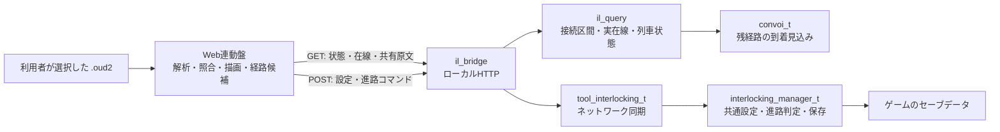
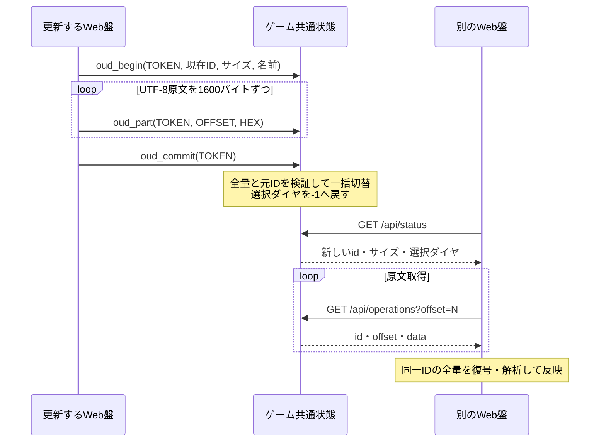

# Web連動盤拡張設計書

作成日: 2026-10-26

本書は、全区間在線表示、OuDiaSecond連携、遅延推定、駅名エイリアス、共有ダイヤ、中継点付き進路の**現在の実装**を説明する。
基盤となる連動装置の構成・信号制御・鎖錠・進路解除は[連動盤設計書](interlocking_panel_design_ja.md)、操作手順は[README](../interlocking/README.md)、通信の完全な書式は[通信仕様](../interlocking/PROTOCOL.md)を参照する。
本書のパスはリポジトリ内の相対パスで記載する。

## 1. 目的と設計方針

- 既存の「連動盤」を初期モードとして維持し、独立した表示モード「全区間在線」を追加する。
- 選択した連動駅から物理的につながる全鉄道区間の線形・信号・実際の列車在線を確認できるようにする。
- ダイヤがなくても在線表示を成立させ、ダイヤがある場合に列車特定・遅延情報を付加する。
- 判断に必要な情報が不足する場合は、列車番号や遅延を推測で確定しない。
- ダイヤ原文・選択ダイヤ・エイリアスはゲームの共通データとして保存する。表示上の好みはブラウザに保存する。
- 中継点を含む進路は全経路のタイル列として扱い、設定時に別経路へ置き換えない。
- 進路操作の最終判定はゲーム本体が行う。Web側の候補表示は本体の判定を代替しない。

## 2. 全体構成と責務

| 実装 | 責務 |
|---|---|
| [il_query.cc](../interlocking/il_query.cc) | 線路の接続探索、実在線、信号、停車状態、駅順序、遅延計算用情報の取得 |
| [simconvoi.cc](../simconvoi.cc) の `calc_panel_ticks_until_arrival()` | 残経路からの到着所要tick計算 |
| [il_eta.h](../interlocking/il_eta.h) | 移動ステップ数を固定小数点で所要tickへ積算 |
| [il_manager.cc](../interlocking/il_manager.cc) | 共有設定の更新、全経路の検証、進路設定、セーブ・ロード |
| [il_operations.h](../interlocking/il_operations.h) | 共有ダイヤの確定済み・送信途中のデータと更新条件 |
| [il_bridge.cc](../interlocking/il_bridge.cc)、[il_tool.cc](../interlocking/il_tool.cc) | HTTP受付、コマンドのネットワーク同期 |
| [core.js](../interlocking/panel/core.js) | 共通状態の取得、定期更新、線路索引・番線・ポイントの構成 |
| [traffic.js](../interlocking/panel/traffic.js) | 表示モード、OuDiaSecond解析、列車照合、遅延表示、共有設定、全区間描画 |
| [operate.js](../interlocking/panel/operate.js) | 中継点状態、進路候補探索、登録経路の優先、経路コマンド生成 |
| [render.js](../interlocking/panel/render.js)、[custom.js](../interlocking/panel/custom.js) | 通常地図・カスタム盤面の表示、線路クリックとゲーム座標の対応 |
| [actions.js](../interlocking/panel/actions.js)、[relay.js](../interlocking/panel/relay.js) | 手動進路登録、ショートカット、電子・継電それぞれの操作 |

WebのJavaScriptは通常のscriptとして順番に読み込まれ、共通スコープを使用する。
読込順は `core → traffic → operate → render → relay → custom → marks → actions`。

## 3. データの所有範囲

| データ | 正本・保存先 | 共有範囲 |
|---|---|---|
| `.oud2` のUTF-8原文、ファイル名、識別子 | ゲーム本体・セーブデータ | 同じゲームの全連動盤・全参加PC |
| 選択中のダイヤ番号 | ゲーム本体・セーブデータ | 同上。未選択は `-1` |
| 駅名エイリアス辞書 | ゲーム本体・セーブデータ | 同上。駅・会社ごとの辞書ではない |
| 登録進路の全タイル列 | ゲーム本体・セーブデータ | 既存の進路同期に従う |
| 読み込んだダイヤの解析結果 | ブラウザのメモリ | 原文から各ブラウザが再構築する |
| 表示モード、駅名の表示方法、早発・遅延許容秒 | ブラウザのlocalStorage | そのブラウザ |
| 指定途中の中継点・編集中のエイリアス | ブラウザのメモリ | その操作画面のみ |

ダイヤ原文とエイリアスをブラウザの旧設定から取り込む移行機能は持たない。
共通設定の同期により、同じゲームを別PCで開いた場合も同じ情報を取得する。PC間でローカルファイルの保存先を共有する必要はない。

## 4. 全区間在線表示

### 4.1 モードと更新

表示モードは `legacy`（画面名「連動盤」）と `network`（「全区間在線」）。自動／扱者、電子／継電とは別の設定である。
従来モードでは `/api/network` を問い合わせない。

共通更新ループは状態・イベント・表示範囲の線路を取得し、全区間モードのときだけ `refreshNetwork()` を呼ぶ。
ループの待ち時間は600ms、全区間在線の取得間隔は約2000msで、リクエスト処理時間により前後する。
駅・モードを切り替えた際は取得対象の識別子を更新し、以前の対象への応答を反映しない。
取得失敗時は前回の在線を消し、取得できていないことを表示する。

### 4.2 接続区間の探索

`GET /api/network?x=&y=&z=` を読み取り専用で実行する。

1. 指定位置が鉄道駅なら、その駅のすべての鉄道ホームを起点にする。駅以外の線路ならその線路を起点にする。
2. 信号の一方通行・予約・ポイントの固定状態でマスクする前の線路方向を使い、隣接する線路をたどる。
3. 探索済みは線路オブジェクト単位で記録する。同一タイル上でも接続しない線路を混同しない。
4. 高低差・橋・トンネルの接続はゲーム本体の隣接判定を使用する。
5. 表示範囲や探索タイル数による打切りは行わない。

ここで取得するのは「物理的につながる線路」であり、「現在の信号現示で列車が走れる範囲」ではない。
`track_count` は到達した地面タイルの重複を除いた数。`tiles` は線路オブジェクトごとのため、同じ座標の要素が複数存在し得る。

### 4.3 実在線と予約の区別

各鉄道編成の各車両が実在するタイルを調べ、接続区間に含まれるものを `occupied` に追加する。
接続区間に1両以上存在する編成を返す。車庫内の編成、予約だけの線路は実在線に含めない。

一方、連動盤の `/api/tracks` の `c` や進路の `occupied` は予約状態を含む。
全区間の実在線と、進路競合を判定するための予約表示は意味が異なる。

| 返却フィールド | 意味 |
|---|---|
| `time` / `seconds` | 1か月を24時間に換算したゲーム内時刻。文字列 `hh:mm:ss` と0〜86399秒 |
| `tiles` | 接続する全線路。座標、物理方向、駅名、信号種類・現示 |
| `convoys[].id/name/pos` | 編成ID、元の車両名、先頭位置 |
| `convoys[].occupied` | 接続区間内で車両が実在するタイル列 |
| `halt/loading` | 在線位置の駅名、停車・乗降中か |
| `service_from/service_to` | 列車の進行方向を特定するための駅順序 |
| `arrival_elapsed` | 到着からの経過秒。停車中で実績がある場合 |
| `next_halt/eta_seconds` | 次のスケジュール地点の駅名、そこまでの推定所要秒。計算できる場合 |
| `schedule_editing` | スケジュール編集中か |

### 4.4 描画

列車の有無とは独立に `tiles` から線形・ホーム・信号を描く。ダイヤ解析結果も必須にしない。
駅名・列車ラベルは縮尺の逆数で補正し、画面上で約14 CSS pxを保つ。
ラベルの位置を画面座標で調整し、引出線で線路上の位置と結ぶ。密集時の配置候補探索には上限があり、あらゆる密度での重なり解消を保証するものではない。

## 5. OuDiaSecondファイルの解析と運用復元

### 5.1 読込と内部形式

利用者が選択したファイルはまずUTF-8として厳密に復号し、失敗した場合はShift-JISとして復号する。
階層形式を解析し、`FileType=OuDiaSecond.`、路線、駅、列車種別、ダイヤ、上下列車を取得する。
ゲームへ共有する原文はUTF-8へ変換する。

ダイヤは `{name, entries}`、各照合エントリはおおむね次の情報を持つ。

| フィールド | 内容 |
|---|---|
| `id` | 方向と列車インデックスから作る列車の識別子 |
| `number/type/destination` | 列車番号・種別・終着駅名 |
| `operation` | 運用番号 |
| `stops` | 走行順の駅名と着発秒。情報なしは `null` |
| `from/to` | この運用が担当する駅インデックスの範囲 |
| `start/end` | その運用区間の開始・終了秒 |

時刻は内部では秒で扱う。列車の着発時刻が前の時刻より小さくなる場合は86400秒を加え、日跨ぎを連続した時刻へ直す。
同じ列車でも途中の運用変更や併結により、複数のエントリを持つ。

### 5.2 運用情報の優先順位

1. 列車に保存された `OperationNumberN` を読み、運用変更位置と複数運用を展開する。
2. 列車側に運用変更情報がない場合、保存された `OperationTable` を使用する。
3. その列車の明示運用がない場合、旧形式の駅作業から復元する。

### 5.3 旧形式の復元

`restoreLegacyOperations()` はOuDiaSecond旧版の `Operation駅番号B/A` と入れ子の駅作業を解釈する。
出区・路線外始発などの運用番号を起点に、駅・番線ごとの時系列と作業の依存関係を構築する。

- 入換での番線・時刻変更、出区／入区連携コードを処理する。
- 増結・解結では運用の配列と順序を維持し、前後のどちらへ連結・分割するかを反映する。
- 運用番号変更・順序反転、上下反転時の設定を反映する。
- 分岐・環状の駅参照を同一の物理駅へ対応付ける。
- 起点時刻を基準にイベントを並べ、設定されている場合は起点時刻を跨ぐ接続も扱う。
- 同一番線・同時刻の接続競合や、番号の起点がない循環は推測で接続しない。

依存関係はキューで評価し、長い列車連鎖を再帰呼出しにしない。入れ子作業の解析深度は64を超えるとエラーにする。

## 6. 列車特定

### 6.1 車両名の正規化

車両名を運用番号として使う。先頭の数字だけの括弧を1組除き、前後の空白を除去する。

| 元の名前 | 照合する運用番号 |
|---|---|
| `(123) A01` | `A01` |
| `（１２）B02` | `B02` |
| `(回送) A01` | `(回送) A01` |

数字の全角・半角は括弧除去の判定で許容する。運用番号本体は文字列一致で照合し、数値化して先頭の0を落とさない。

### 6.2 時間窓と駅順序

`matchOperation()` の処理は次のとおり。

1. 正規化した運用番号と一致するエントリを選ぶ。
2. 基本の時間窓を運用区間の `start〜end` とする。
3. 現在駅に対応する着発時刻がある場合、その駅の到着〜発車を時間窓にする。
4. 開始側から早発許容秒を引き、終了側へ遅延許容秒を加える。境界は候補に含める。
5. ゲーム内秒に `-1, 0, 1, 2` 日を加えた値で日跨ぎを照合する。同じ列車IDの候補はまとめる。
6. `service_from → service_to` と、候補列車の駅の順序を比較する。

早発許容は初期120秒、遅延許容は初期1800秒。いずれも0〜86399秒で、ブラウザごとに設定する。
次駅が候補内で既知なら次駅を含む候補へ絞り、前駅も既知なら前駅より後に次駅が現れる候補へ絞る。
駅情報が未知の場合は、それだけを理由に候補を除外しない。

| 結果 | 表示 |
|---|---|
| ダイヤ未選択・未読込 | 運用照合なし |
| 候補0件 | 列車未特定 |
| 候補1件 | 列車番号・種別・行先 |
| 候補複数 | 候補複数。詳細一覧に候補を列挙 |

### 6.3 折り返しとスケジュール編集

走行中の前駅はスケジュールを遡り、経由地・通過指定を飛ばして求める。停車中は現在駅を前駅側として扱う。
スケジュール編集で値が書き換わる運賃計算用の `last_stop_pos` は参照しない。
駅停車中に編集画面を開いた場合は、現在駅・経路終端・車両の停止位置から停車状態を補完する。
この情報を編集の前後で保つことで、折り返し前の列車への逆戻りや、停車中の遅延情報の消失を防ぐ。

## 7. 遅延・到着見込み

### 7.1 表示基準

`trainDelay()` は列車が一意に特定された場合だけ計算する。前駅の実発車時刻との差は採用しない。

| 状態 | 計算・表示 |
|---|---|
| 停車中で到着実績あり | `現在秒 − arrival_elapsed − ダイヤ着時刻`。「到着基準」 |
| 所定発車を過ぎても停車中 | 現在秒と所定発車の差が到着遅延より大きい場合、その差を「発車待ち」として表示 |
| 始発駅で着時刻なし | 所定発車までの待機は定刻。所定発車後は発車待ちの遅延 |
| 走行中で到着見込みあり | `現在秒 + eta_seconds − 次駅の所定着時刻`。「到着見込」。着時刻がなければ発時刻を使用 |
| 必要な情報なし | 遅延不明 |

日跨ぎの差は `[-43200, 43200)` 秒へ正規化する。同じ駅が複数現れる場合は実時刻に最も近い所定時刻を選び、同距離の候補が残る場合は確定しない。
走行中は「推定遅延／定刻見込／早着見込」とし、実到着による遅延と区別する。
赤文字にするのは遅延が60秒以上の場合だけで、列車番号・行先の色は変えない。

### 7.2 ゲーム本体の到着予測

`calc_panel_ticks_until_arrival()` は現在位置が残経路と対応することを確認し、残る各タイルについて次を計算する。

1. 編成・連結編成・スケジュール等の速度制限、線路・電化設備の速度制限から区間速度を求める。
2. 現在タイルは進行済みステップを差し引き、以後のタイルは直線・斜めそれぞれの実移動ステップ数を用いる。
3. 終端付近の減速速度上限と、最終タイル内の実際の停止位置を反映する。
4. 移動速度倍率を反映し、`il_eta_t` で小数tickを保持したまま積算し、最後に丸める。
5. ゲーム内の1か月＝86400秒に換算して `eta_seconds` にする。

従来の発車案内で使う通過済み区間の平均速度や `900/1024` 補正には依存しない。
一定の条件で走行するとき、経過時間の増加と残所要時間の減少が釣り合うことを狙う。

予測は加速過程・勾配・曲線抵抗・将来の信号待ちを完全にシミュレーションしない。
経路と現在位置の不一致、線路欠落、速度条件の不成立などでは所要時間を返さず、Web側は遅延不明にする。

## 8. 駅名エイリアス

辞書の形は `[[ゲーム内駅名, OuDiaSecond駅名], ...]`。対応は片方向・1段で、連鎖置換しない。
表示をゲーム内駅名にしていても、列車照合・遅延計算にはエイリアスを適用する。

| 項目 | 仕様 |
|---|---|
| 更新 | `alias_set` で1件登録・上書き、`alias_del` で削除 |
| 上限 | 512件、各駅名UTF-8で512バイト以内 |
| 入力検証 | 空文字・制御文字を拒否。Webでは同じゲーム駅名の重複も拒否 |
| 共有 | `/api/status.station_aliases` で取得。駅・会社に依存しない共通設定 |
| 表示切替 | 「駅名：ゲーム内／エイリアス」。両表示モードで共通のブラウザ設定 |

保存操作は編集開始時の辞書との差分をコマンド列として順に送る。辞書全体の一括トランザクションではなく、途中失敗時には一部が反映済みの場合がある。
編集中に別の盤から更新された場合は、共有辞書を受信して照合に反映しつつ、編集中の入力は残して更新を通知する。完全な競合排除機構ではない。

## 9. ダイヤの共有と永続化

### 9.1 共有ダイヤの状態

`il_operations_t` は次の2種類を分離して持つ。

- 確定済み: `id/file/source/diagram`。
- 送信途中: `upload/base/upload_file/expected/staged`。

ブラウザは原文を解析して運用を読めることを確認した後に送信する。
本体はサイズ・識別子・バイト列・OuDiaSecondのヘッダ等を検証するが、運用の意味解析は行わない。

### 9.2 コマンドと整合性

| 操作 | 条件・結果 |
|---|---|
| `oud_begin` | 32桁の小文字16進TOKEN、現在ID一致、正のサイズ、ファイル名を検証。新しい送信開始は以前の送信途中状態を置き換える |
| `oud_part` | TOKENと次のOFFSETが一致し、1〜1600バイトで受信予定量を超えないこと。NUL・不正な16進表現等を拒否 |
| `oud_commit` | 全量受信、開始時の元IDが現在IDと一致、ヘッダが正しい場合に確定。選択は未選択へ戻す |
| `oud_select` | 対象IDが現在IDと一致する場合に選択ダイヤ番号を更新 |
| `oud_clear` | 対象IDが一致する場合に原文・選択・送信途中状態を解除 |

ファイルはUTF-8変換後8MiB以下、ファイル名はUTF-8で512バイト以内。
本体の `oud_select` はインデックスの整数範囲を検証する。実在するダイヤ番号かはWeb側の解析結果で判定し、不正な選択は未選択として表示する。
送信の中断・競合・コミット失敗で、確定済みの原文を部分データへ置き換えない。
取得側も4096バイト以下の応答ごとにID・サイズ・OFFSETを確認し、異なる版の原文を混ぜない。

### 9.3 セーブ形式

連動装置の長さ付き保存ブロックは現在version 18。
version 17以降に共有エイリアス、version 18以降に共有ダイヤを保存する。
ダイヤは送信途中状態も保存し、ネットワーク途中参加やセーブ再読込後の後続チャンクの条件を一致させる。
旧セーブでは追加データなしで初期化する。旧実装による未知部分の読み飛ばしは、長さ付きセクションの既存の仕組みに従う。

通信は既存の `tool_interlocking_t` を介して同期する。別PCのWeb盤は各PC上のゲームへ接続し、他PCのローカルHTTPポートへ直接接続する構成ではない。

## 10. 中継点付き進路

### 10.1 操作状態と入力

`routeVia` は通過順の座標配列、`routeViaPicking` は追加中か、`routeViaContext` は駅・タブ・始点・入換選択の識別子を保持する。
指定は最大16か所。始点・既存の中継点・連動盤の接続範囲外は追加しない。
始点・駅・タブ等の文脈が変わると指定を解除する。Escは中継点指定と手動作成を中止する。

| 状態 | 画面と操作 |
|---|---|
| 手動作成開始・始点未選択 | 手順1を表示。中継点ボタンは無効 |
| 始点選択済み | 「中継点を指定」を選ぶか、そのまま着点へ進む |
| 中継点追加中 | 通過順に線路をクリック。番号付きマーカーを表示。「1つ戻す」「中継点を消去」が使える |
| 指定終了 | 着点を選ぶ。手動登録では名前を入力する |

手動作成の操作欄は設定タブの「6. 進路」に置き、運転時の操作欄は地図側に置く。
通常地図ではタイル・信号・分岐器等から座標を取得する。
カスタム盤面の線路は、クリック位置を線分へ射影して結び付け済みのタイル列から座標を選ぶ。ポイント・信号・着点記号も対応座標を使う。

### 10.2 候補経路の探索

`findDestinations()` の探索状態は「タイル・進入方向・通過済み中継点数」。次の中継点へ到達したときだけ通過済み数を増やす。
後の中継点を先に通過しても順序条件は満たさない。同じタイルを再訪する経路は生成しない。
番線・留置線・出口・車庫への候補は、全中継点を順に通る場合だけ記録する。

片方向の通行制限・ポイントの固定方向・予約・他進路を考慮する。
空き経路と支障のある経路を分けて探索し、支障経路は「着点があるが今は設定できない」状態として表示できる。
緑の入換・ピンクの誘導で使う「列車手前」の短縮候補も、中継点の順序条件を満たす必要がある。
手動登録の `manualPathVia()` も、順序を持つ探索で具体的な全タイル列を作る。

### 10.3 登録済み進路の優先

信号と着点ボタンで設定する場合も、同じ駅・始点・着点に対応する `temp:false` の登録進路を参照する。
着点の対応は番線・留置線のグループ、出口タイル、車庫で判定し、番線の端が完全一致しなくても対応付ける。

1. 対応する登録進路がある着点について、自動探索で得た別経路の候補を除く。
2. 登録済みタイル列の存在・接続・進む向き・ポイント固定・中継点条件を検証する。
3. 必要なら終端の同一番線・留置線内を延長する。保存経路の途中の分岐は変更しない。
4. 複数の登録経路があれば、状態の列挙順を基準に設定可能な候補を優先する。
5. 対応登録経路がすべて無効・支障の場合、任意の自動探索経路へ切り替えない。

着点操作で送信する動的進路にも登録進路の名称を使用する。
これは「着点操作時の経路選択」の規則である。利用者が明示的に実行する「配線を読み直す」には、通れなくなった進路を同じ両端で引き直す既存処理が別途ある。

### 10.4 本体への送信と保存

| 用途 | コマンド |
|---|---|
| 通常のその場設定 | `set_path` |
| 電子連動の入換・誘導てこから設定 | `set_path_s` |
| 中継点付きの手動登録 | `rt_path` |
| 中継点なしの手動登録 | 従来の `rt_def` |

全経路は `x:y:z;x:y:z;...` として送る。UTF-8コマンドが4000バイトを超える場合は送信せず、進路を分けるよう表示する。
継電では事前に信号てこを開通方向へひねり、入換／誘導の種別は倒したてこから本体が判定する。
本体が全経路・操作権限・競合・予約・固定ポイント等を検証した上で設定する。

中継点そのものの配列を本体へ別フィールドで保存する方式ではない。
中継点を通る全タイル列を既存の進路データへ保存するため、同期・回転・セーブ・ロードも既存の進路の仕組みを使用する。

## 11. 異常時の扱いと性能上の制約

| 状況 | 扱い |
|---|---|
| ダイヤ未読込・未選択 | 線形・信号・実在線を表示し、列車番号の照合を行わない |
| 列車候補が複数 | 全候補を保持し、遅延は不明 |
| エイリアス不足・駅情報不足 | 不明な駅名を方向判定の根拠にせず、判定できない遅延は不明 |
| 全区間APIの失敗・ゲーム切断 | 古い在線一覧と地図を消し、未取得状態を表示 |
| ダイヤ取得中に版変更 | 応答を混在させず、状態更新に従って再取得 |
| ダイヤ送信中断 | 確定済み原文を維持。送信途中状態を保存可能 |
| エイリアス保存途中の失敗 | 一部適用の可能性を表示して、共有状態を確認できるようにする |
| 中継点へ到達不能 | その中継点を省略した経路を設定しない |
| 登録経路の支障 | 別の自動探索経路へ置き換えない |

全区間取得は要求ごとに接続線路と編成を調べる。大規模な接続網ではレスポンス量・探索時間・SVG描画負荷が増える。
現実装に区間分割取得やサーバ側の接続網キャッシュはない。全区間表示は操作用の連動範囲を拡張するものではない。
HTTP受付のHost検証・POSTの `X-IL-Panel: 1` 必須条件などは[通信仕様](../interlocking/PROTOCOL.md)に従う。

## 12. テストとの対応

| 設計対象 | テスト | 主な期待結果 |
|---|---|---|
| 新旧ダイヤ・運用復元・時間窓・折り返し | [panel_traffic_test.mjs](../interlocking/tests/panel_traffic_test.mjs) | 境界秒を含む正しい候補、競合・不明時に推測しない |
| モード・描画・遅延色・共有取得 | [panel_traffic_browser_test.mjs](../interlocking/tests/panel_traffic_browser_test.mjs) | 列車なし・ダイヤなしでも表示、59秒は通常色／60秒は赤、別ブラウザへ共有 |
| 到着予測の積算 | [network_eta_test.cc](../interlocking/tests/network_eta_test.cc) | 一定速度の直線・斜め区間で予測が安定、速度倍率と残区間の速度変更を反映 |
| エイリアス保存 | [aliases_blob_test.cc](../interlocking/tests/aliases_blob_test.cc) | 日本語・空辞書の復元、破損データの検出 |
| ダイヤ共有状態 | [operations_blob_test.cc](../interlocking/tests/operations_blob_test.cc) | 分割送信・競合・中断・保存復元・選択の整合性 |
| 実セーブ・再起動 | [operations_save_test.ps1](../interlocking/tests/operations_save_test.ps1) | 原文と選択の復元、途中送信からの再開 |
| スケジュール編集 | [panel_schedule_test.py](../interlocking/tests/panel_schedule_test.py) | 走行・停車それぞれで開閉前後の駅順序・在線・計算用情報を維持 |
| 中継点と登録経路 | [route_via_test.mjs](../interlocking/tests/route_via_test.mjs) | 各進路種別の通過順、循環・支障・固定ポイント、不正な別経路への切替防止 |
| 中継点の画面操作 | [route_via_browser_test.mjs](../interlocking/tests/route_via_browser_test.mjs) | 電子・継電、通常地図・カスタム盤面、手動登録、操作案内、登録経路の利用 |

直近の修正時に再実行したのはJavaScriptの上記4本。ブラウザテストは模擬APIに対する操作・送信経路の確認を含む。
実ゲームの登録進路「1L」については、データを読み取って模擬画面へ再生し、保存済み15タイルを同じ順序で含むことも確認した。ゲーム内で列車を走行させる確認とは区別する。

PRの手動確認では、実列車が設定した分岐を通ること、物理的な別PCとの同期、勾配・曲線・信号待ちを含む推定遅延の変動を確認する。
テストの存在・検証範囲と、その時点での実行結果は区別し、PRには実行した条件・結果を別途記録する。
